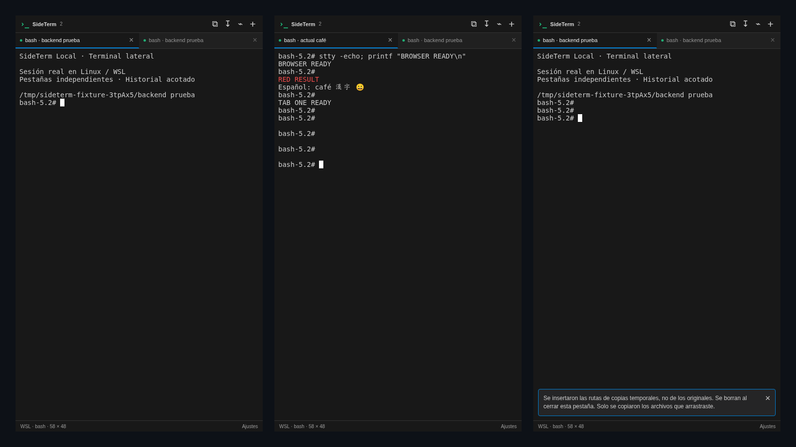
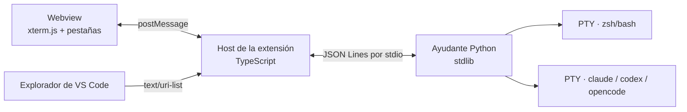

# SideTerm

<p align="center">
  
</p>

<p align="center">
  
  
  
  
  <a href="LICENSE"></a>
</p>

**Terminales reales en pestañas dentro de la barra lateral de VS Code, pensadas para trabajar con agentes de código.** Ejecuta Claude Code, Codex u OpenCode en un lateral mientras el editor y el panel Terminal quedan libres para revisar lo que el agente cambia.

<details>
<summary><strong>English summary</strong></summary>

SideTerm is a VS Code extension that opens real terminals in tabs inside the secondary sidebar, without replacing the built-in Terminal panel. It is designed for **AI-assisted development**: run Claude Code, Codex, or OpenCode beside your code while the editor stays free for reviewing diffs.

- Detects coding agents (Claude, Codex, OpenCode) and names each tab after the running process and its current folder.
- Real PTYs through a dependency-free Python helper (Linux `/proc`, macOS `libproc` via `ctypes`) and an xterm.js webview. No production npm dependencies.
- Drag-and-drop inserts only the quoted file path, never file contents or editor context, so nothing reaches an agent without your action.
- Works on WSL2/Linux and macOS. Tested with real PTYs plus Node and Python suites; browser checks use a simulated VS Code API.
</details>

## Por qué existe

Los agentes de código viven en la terminal, pero la terminal de VS Code compite por espacio con el editor y los diffs. SideTerm mueve esas sesiones a la barra lateral, con pestañas independientes que muestran qué agente corre en cada una, para tener el agente a un lado y el código delante.

## Lo que lo hace interesante

- **Hecho para agentes de IA:** detecta Claude Code, Codex y OpenCode en cada PTY y usa su nombre en la pestaña, junto a la carpeta actual.
- **Contexto solo a propósito:** soltar un archivo inserta únicamente su ruta entre comillas, sin pulsar Enter. SideTerm no lee el editor activo, las selecciones ni el portapapeles; una prueba falla si lo intenta.
- **PTYs reales sin dependencias nativas:** un ayudante Python de solo biblioteca estándar gestiona los procesos y habla con la extensión por JSON Lines sobre stdio privado, sin sockets en escucha. En macOS lee procesos con `libproc` mediante `ctypes`, sin `/proc`. Instalar el VSIX no requiere npm, pip ni compiladores.
- **Multiplataforma con límites documentados:** WSL2/Linux y macOS, shell de login en macOS para leer `.zprofile`, y transferencia por bloques de 64 KiB con cuotas cuando el archivo viene del escritorio de Windows.
- **Pruebas sobre comportamiento real:** suites de Python y Node con PTYs reales (`bash` y `zsh`) y comprobaciones de interfaz en Chromium. Lo que no se probó está escrito en [PRUEBAS](docs/PRUEBAS.md).

**Stack:** TypeScript (strict) · VS Code Extension API y Webview · xterm.js · Python 3.8+ (stdlib, `pty`, `ctypes`) · Node test runner · `unittest`.

## Arquitectura



## Detalles de la versión 0.2.0

Terminales reales en pestañas en la barra lateral secundaria de VS Code. Mantiene la Terminal nativa abajo y los archivos en el editor. Extensión privada para **WSL2/Linux y macOS**, no publicada en Marketplace.

## Nuevo: arrastrar archivos, sin contexto automático

Cuando la webview recibe un archivo soltado, SideTerm inserta **únicamente su ruta**, entre comillas, sin pulsar Enter. Admite múltiples archivos y rutas de WSL. Si recibe un archivo del escritorio sin ruta, pide permiso para transferir **ese archivo** a una copia temporal privada en WSL, por bloques de 64 KiB. En VS Code 1.140.0 sobre Windows + WSL2, el arrastre desde el Explorador de VS Code no llega a la webview de la terminal. Desde 0.1.3, suelta esos archivos en la vista **Soltar archivos** del panel de SideTerm o usa **Insertar ruta en SideTerm** en el menú contextual del Explorador; consulta la [guía](docs/GUIA.md#arrastrar-desde-el-explorador-de-vs-code).

No toma el archivo abierto, no escanea editores ni añade selecciones automáticamente. Las integraciones de contexto propias de OpenCode/Claude son independientes y no se modifican.

**Actualizar:** guarda y cierra las sesiones → `Extensions: Install from VSIX...` → instala `sideterm-local-0.2.0.vsix` (en WSL, en la ventana remota; en macOS, en la ventana local). No restablezcas las vistas ni desinstales la versión anterior.

[Guía de instalación, arrastre y límites](docs/GUIA.md) · [Pruebas](docs/PRUEBAS.md)

## Funciones conservadas

Pestañas independientes, título de proceso y carpeta actual, alias manuales, ancho equitativo con mínimo configurable, selector de carpeta en workspaces múltiples, copiar/pegar texto, redimensionamiento, confirmación de cierre y diagnóstico bajo demanda. Un ayudante Python compartido y una webview, sin servidor de ejecución propio ni dependencias npm de producción.

## Requisitos

VS Code 1.85+, host de extensión WSL/Linux o macOS y Python 3.8+ (en macOS sirve el `python3` de las Command Line Tools o el de Homebrew). Para instalar el VSIX no necesitas npm, pip, compiladores ni la extensión Python de VS Code. El shell se ejecuta con los permisos de tu usuario; no uses workspaces no confiables.

## macOS (desde 0.2.0)

- Instala el VSIX en una ventana local de VS Code; las terminales se abren en el Mac. También funciona con Remote-SSH hacia un Mac.
- Sin `/proc`, el ayudante lee procesos con `libproc` (vía `ctypes`, solo biblioteca estándar): nombre de la pestaña, carpeta actual y detección de OpenCode/Claude/Codex.
- Si no cambias `sideterm.shellArgs`, el shell arranca como **login** (`-l -i`), como Terminal.app, para leer `.zprofile` (Homebrew, nvm…). Personalízalo y se respetará tal cual.
- Copiar/pegar: `Cmd+C` / `Cmd+V`. `Option` solo no se reenvía a VS Code (evita que la barra de menús robe el foco).
- No hay conversión de rutas de Windows: en macOS solo se aceptan archivos locales.

## Límites importantes

Las sesiones no sobreviven a cerrar/recargar VS Code. Ctrl+V pega texto, no imágenes del portapapeles. El arrastre desde el Explorador de VS Code directamente sobre la terminal no funciona en el entorno comprobado; usa la vista **Soltar archivos** o el menú contextual. No integra toda la experiencia de tareas, depuración o enlaces de la Terminal nativa. No transfiere archivos a hosts SSH ni contenedores anidados. Copias temporales: 20 MiB/archivo, 40 MiB/arrastre, 128 MiB/sesión. Un cierre forzoso puede dejar restos temporales.

Se probó en Linux con PTYs reales y Chromium con API de VS Code simulada. La grabación y las herramientas de desarrollo en VS Code/Windows/WSL2 permitieron observar la limitación del arrastre desde el Explorador; no se validó la transferencia desde el escritorio Windows ni con cuentas autenticadas de agentes. Las pruebas automatizadas de arrastre son sintéticas.

## Desarrollo

```bash
npm install
npm run build
npm test
python3 scripts/package.py --out-dir /ruta/de/salida
```

El código fuente contiene tests, un emulador de las API públicas de VS Code y una prueba opcional de Chromium. No forman parte del instalable. El componente terminal utiliza xterm.js y su addon de ajuste; consulta `THIRD_PARTY_NOTICES.md` para licencias.

## Ajustes principales

`sideterm.tabMinWidth` (140 px), `sideterm.scrollback` (1.000 líneas), `sideterm.maxSessions` (6), `sideterm.cursorBlink` (false), `sideterm.shell`, `sideterm.shellArgs`, `sideterm.pythonPath`, `sideterm.fontSize`, `sideterm.confirmClose`, `sideterm.confirmMultilinePaste`.
